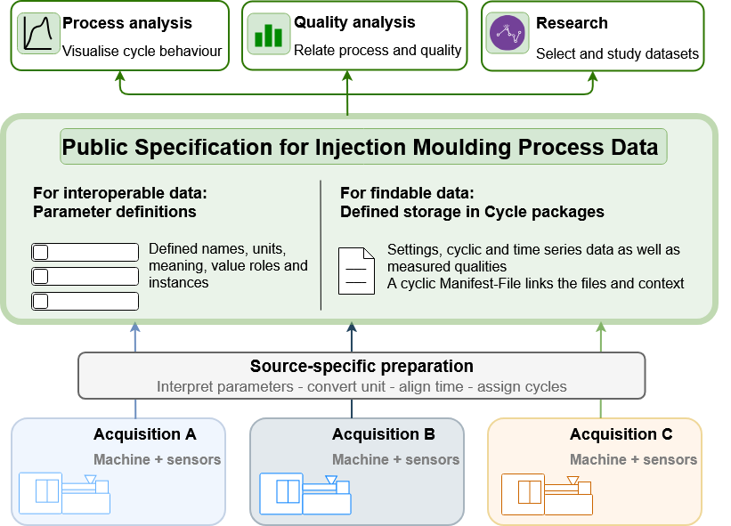

# Injection Moulding Data Specification

This repository provides a specification for the long-term preservation and reuse of injection moulding process data. This specification offers a common interface between data acquisition and downstream applications. By separating data representation from machine-specific acquisition, it aims to reduce repeated data preparation and support the reuse of analysis tools across manufacturers and datasets.

A parameter catalogue defines quantities, units and instance names. A folder for each machine cycle brings together settings, cyclic measured actual values, time series data and quality observations. An additional manifest connects their context and further metadata.

The scope of this version is conventional thermoplastic injection moulding with one injection unit. The catalogue version `1.0` contains 220 parameter definitions: 134 Core, 39 Draft and 47 Experimental. The documentation is in English; parameter descriptions are available in English and German.

## Associated publication

This specification accompanies the manuscript `A FAIR-oriented specification for the long-term preservation and reuse of injection moulding process data`, submitted to Scientific Data.

## How to use the specification

We recommend following approach to achive a structured and defined data basis for injection moulding process data, which 
 findable, accessible, interoperable and reusable data basis.

1. **Understand the source data.** Establish the machine, cycle boundaries, reported quantities, units and acquisition times. Keep the available source documentation with the dataset.
2. **Choose matching definitions.** Find each value in [parameterDefinition.json](parameterDefinition.json). Check its meaning, role, representation, unit and maturity using the [parameter guide](docs/parameter_definition.md). Use the declared [instance patterns](docs/instances_and_representative_values.md) for zones, cavities, devices and profile segments.
3. **Assign values to cycles.** Apply a documented [cycle-value selection](docs/cycle_value_selection.md). Preserve the time origin and any transformations of sampled signals.
4. **Create the package.** Write the CSV files and `manifest.json` according to the [package layout](docs/data_structure.md). Add [quality observations](docs/quality_long_draft.md) and their [inspection context](docs/quality_inspection_template.md) when available.
5. **Check the result.** Follow the [validation guide](docs/validation_rules.md), then compare the exported values and their interpretation with the source.

In the context of an existing dataset, start with [reading and assessing data](docs/reading_data.md). It explains what to check before comparing cycles or combining datasets.

## Examples and conversion

| Material | What it demonstrates |
| --- | --- |
| [Measured cycle 96184](example/Manufacturer-MachineType-MachineID/96184/README.md) | Prepared data from a physical Arburg machine, with settings, actual values and time series. No detailed quality observations or overall quality assessment are provided. |
| [Fictional cycle 000001](example/FictionalManufacturer-FictionalMachineType-FictionalMachineID/000001/README.md) | All six resource roles, profiles, heating zones and detailed quality observations. It serves only as an example for the file structures. All identifiers and values are fictional. |
| [CSV converter](tools/csv_to_cycle_package/README.md) | A runnable example for converting an already aligned CSV using an explicit column mapping and context configuration. |

The converter requires Python 3.10 or later. Its examples are synthetic, and it did not generate the measured package. Source-specific acquisition, unit conversion and alignment must be completed before using it. The [dataset correspondence register](docs/dataset_parameter_mappings.md) can help interpret published source names; it is separate from the converter's mapping configuration.

## Reference files

| File | Purpose |
| --- | --- |
| [parameterDefinition.json](parameterDefinition.json) | Parameter meanings, units, roles, maturity and instance rules. |
| [parameterDefinition.schema.json](parameterDefinition.schema.json) | Structure of the parameter catalogue. |
| [manifest.schema.json](manifest.schema.json) | Required cycle identity, resource inventory and selected context constraints. |
| [docs/assetVocabulary.json](docs/assetVocabulary.json) | Controlled asset codes used by the catalogue. |
| [mappings/datasetParameterMappings.json](mappings/datasetParameterMappings.json) | Qualified correspondences to published dataset fields. |

Search queries and screening records, used in for the accompaning publication, are retained under [research/](research/). The parameter guide explains the catalogue's informative standards references and versioning rules.

## Status and reuse

Core, Draft and Experimental describe the maturity of a definition, not the accuracy of an observation. 
Core definitions describe interoperable parameters, while Draft parameters need further context to achive interoperable values. Experimental parameters need further research to achive interoperable values through context and measuring methods.

Quality-Long defines a six-column layout for detailed quality observations for the wide spectrum of observable qualities in injection moulding; no separate machine-readable schema is supplied. Machine-specific measurement methods, representative-value calculations and quality criteria remain part of the dataset documentation.

Keep the exact catalogue used with the data when archiving or exchanging a package. The catalogue, manifest format, correspondence register and CSV converter use version `1.0`. Versions and release designations of referenced datasets and standards identify those external sources.

## Funding

The specification was developed within the framework of an industrial contract research project, which was funded by KME – Kompetenzzentrum Mittelstand GmbH.

## Competing interests

The industrial project partners are interested in ensuring the long-term usability of the data and results generated within the research project. This specification has been made openly available under the CC BY 4.0 license, to encourage its reuse beyond the original project, including by third parties.
